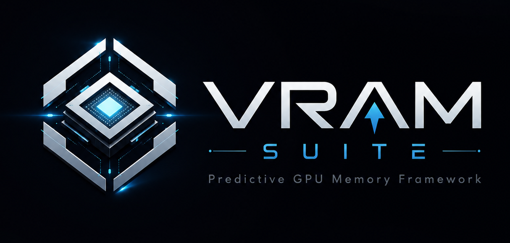
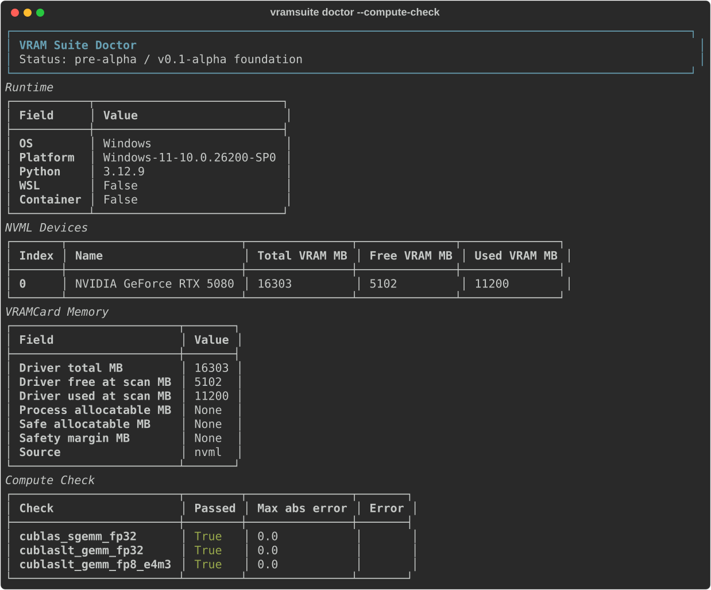
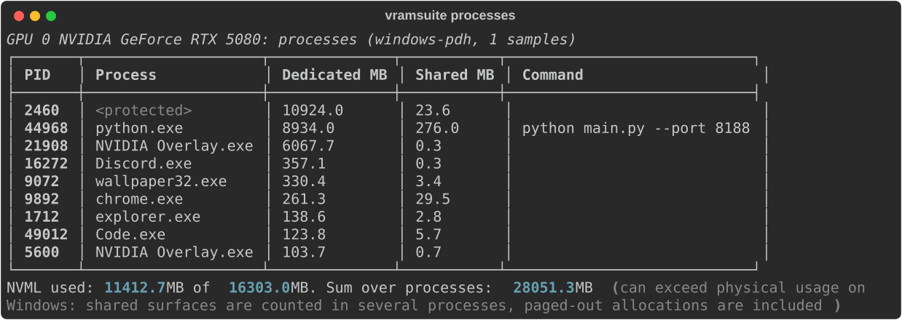
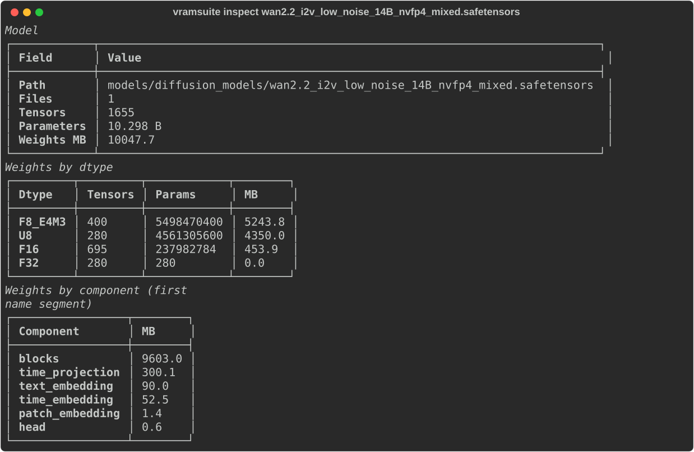
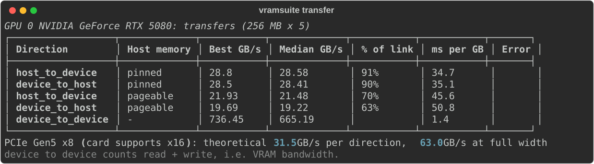
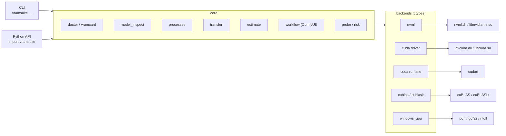

<p align="center">
  
</p>

<p align="center">
  <b>Native GPU memory diagnostics for local AI.</b><br>
  Know whether your workflow fits in VRAM before it crashes with out-of-memory.
</p>

<p align="center">
  
  
  
  
  
  
</p>

---

VRAM Suite talks to NVIDIA libraries directly (NVML, CUDA driver and runtime, cuBLAS, cuBLASLt) and shows what is really happening with GPU memory: what the card is, who holds VRAM, how big a model is, and how fast weights move over PCIe.

## Quick start

```bash
uv sync
uv run vramsuite doctor --compute-check
```

<p align="center">
  
</p>

## Commands

| Command | What it does | Docs |
|---|---|---|
| `vramsuite doctor` | GPU profile, driver memory, `.vramcard` file | [Device profile](docs/device-profile.md) |
| `vramsuite doctor --compute-check` | cuBLAS / cuBLASLt FP32 and FP8 GEMM correctness | [Compute check](docs/device-profile.md#compute-check) |
| `vramsuite doctor --probe --estimate-mb N` | Safe allocatable budget and OOM risk | [Probe and risk](docs/probe-and-risk.md) |
| `vramsuite inspect <model>` | Exact weight sizes per dtype from `.safetensors` headers | [Model inspection](docs/model-inspection.md) |
| `vramsuite processes [--watch S]` | VRAM per process, with peaks | [Process tracking](docs/process-tracking.md) |
| `vramsuite transfer` | Real RAM <-> VRAM bandwidth over PCIe | [Transfer benchmark](docs/transfer.md) |
| `vramsuite estimate <models>` | Will models fit in VRAM, and what offloading the rest costs per step | [Memory estimate](docs/estimate.md) |
| `vramsuite estimate --workflow <file.json>` | The same for a ComfyUI workflow: finds the models it loads | [Memory estimate](docs/estimate.md#comfyui-workflows) |
| `vramsuite profile` | Records peak VRAM and run time of the next ComfyUI prompts; `estimate` uses them | [Workflow profiles](docs/profiles.md) |
| `vramsuite analyze-workflow <file or folder>` | Models, resolution / frames / steps, config hash and risky patterns of ComfyUI workflows | [Workflow analysis](docs/workflow-analysis.md) |
| `vramsuite compare a b` | Diff of two `.vramcard` profiles | [`.vramcard` format](docs/vramcard.md) |
| `vramsuite validate card.json` | Structure and sanity check of a `.vramcard` (exit code 1 if invalid) | [`.vramcard` format](docs/vramcard.md#validating-a-card) |

Every command supports `--json`. Full documentation: [docs/](docs/README.md).

## Why native

- **No PyTorch, no Triton.** A diagnostic tool should not load gigabytes of framework and its own CUDA libraries just to read how much memory is free. PyTorch is only detected from package metadata.
- **No DLL conflicts.** Importing torch makes Windows bind cuBLAS to torch's copy of cuBLASLt by name. VRAM Suite never imports it, so its numbers are not affected by a second CUDA stack.
- **Observes from outside.** ComfyUI, games and browsers are measured through OS and driver counters; nothing has to run inside them.
- **Explicit and bounded.** Nothing heavy runs by default, every allocation is released, and a value that cannot be read is reported with a reason instead of disappearing.

More: [Native backends](docs/native-backends.md).

## See it work

**Who holds VRAM right now** — `vramsuite processes`

<p align="center">
  
</p>

**How big a model really is** — `vramsuite inspect` on a WAN 2.2 14B NVFP4 checkpoint: FP8 and packed FP4 weights, read from the header in milliseconds

<p align="center">
  
</p>

**What offloading costs** — `vramsuite transfer`

<p align="center">
  
</p>

## Real numbers

Measured on an RTX 5080 in a slot that runs at PCIe Gen5 x8:

| | Bandwidth | Time per GB |
|---|---:|---:|
| VRAM (device to device) | ~800 GB/s | 1.2 ms |
| PCIe, pinned memory | 28.5 GB/s | 35 ms |
| PCIe, pageable memory | ~19 GB/s | ~52 ms |

VRAM is about 30 times faster than the link to system RAM. That gap is why a model that does not fit in VRAM slows down so much when its weights are offloaded, and why VRAM Suite measures both.

## Architecture



```text
vramsuite/
  __init__.py          Public Python API
  cli/main.py          CLI entrypoint
  core/
    doctor.py          Structured diagnostics API (+ native compute checks)
    fingerprint.py     Runtime, NVML, CUDA runtime, cuBLAS, torch-metadata fingerprint
    vramcard.py        .vramcard creation, GPU matching (NVML <-> CUDA by PCI)
    probe.py           Bounded allocation probe (cuMemAlloc)
    risk.py            Basic OOM risk estimation
    model_inspect.py   .safetensors header reader (exact weight sizes)
    processes.py       Per-process VRAM usage and peaks
    transfer.py        Host <-> device bandwidth benchmark
    estimate.py        Workflow memory estimate and offloading cost
    workflow.py        ComfyUI workflow JSON -> models, settings, hashes, warnings -> estimate
    profile.py         Passive ComfyUI run capture: peak VRAM + run time per config hash
    compare.py         .vramcard comparison
    reports.py         Rich terminal report rendering
    runtime.py         OS/Python/WSL/container detection
  backends/
    native_loader.py   DLL/.so discovery (CUDA Toolkit first, venv fallback)
    nvml.py            NVML: memory, device details, PCIe, clocks, power, processes
    cuda.py            CUDA runtime: memory, device attributes, malloc/memcpy, pinned memory
    cuda_driver.py     CUDA driver API: probe and transfers with only the NVIDIA driver installed
    cublas.py          cuBLAS handle and SGEMM
    cublaslt/          cuBLASLt descriptors, heuristics, matmul
    windows_gpu.py     Windows PDH GPU counters, LUID -> PCI, process info
  compute/
    compute_math.py    cuBLAS SGEMM sanity check
    cublaslt_math.py   cuBLASLt FP32 / FP8 GEMM checks
    minifloat.py       Pure-Python FP8 / FP4 encode/decode
```

## Python API

```python
import vramsuite

result = vramsuite.run_doctor(with_compute_check=True)
print(result["gpu"])
print(result["memory"])

card = vramsuite.create_vramcard()
vramsuite.save_vramcard("system.vramcard.json", card=card)
```

```python
from vramsuite.core.model_inspect import inspect_model
from vramsuite.core.processes import watch_gpu_processes
from vramsuite.core.transfer import run_transfer_benchmark

print(inspect_model("model.safetensors")["total_mb"])
print(watch_gpu_processes(seconds=30)["processes"][:3])
print(run_transfer_benchmark()["results"])
```

## Roadmap

- [x] Native CUDA runtime, cuBLAS and cuBLASLt backends (no PyTorch)
- [x] CUDA driver API backend: probe and transfers without the CUDA Toolkit
- [x] Device profile in `.vramcard`, NVML <-> CUDA matching by PCI address
- [x] Compute check layer (cuBLAS / cuBLASLt FP32, FP8)
- [x] Model file inspection from `.safetensors` headers
- [x] Per-process VRAM tracking (Windows PDH / Linux NVML)
- [x] Host <-> device transfer benchmark
- [x] Workflow memory estimation: weights + activations + offloading cost vs the device profile
- [x] ComfyUI workflow analysis
- [x] Profile validation and schema checks
- [x] Offline workflow analysis: settings, graph / config hashes, risky patterns (v0.2)
- [x] Workflow profiles: real peak VRAM and run time from ComfyUI, used by estimate (v0.3)

Out of scope (separate kernel project): custom attention kernels, FP4 block-scaled GEMM, kernel autotuning.

## Tested on

| | |
|---|---|
| GPU | NVIDIA GeForce RTX 5080 (Blackwell, sm_120, 16 GB) |
| Driver | 617.14, CUDA driver 13.4 |
| CUDA Toolkit | 13.0 (only needed for `doctor --compute-check`) |
| OS | Windows 11 (WDDM), WSL2 |
| Python | 3.12 via `uv` |

Other NVIDIA GPUs should work; FP8 compute checks need Ada (sm_89) or newer.

## Status

Alpha (v0.3). The CLI, `.vramcard` format and Python API can still change between versions.

## License

[MIT](LICENSE) © k1n0F
